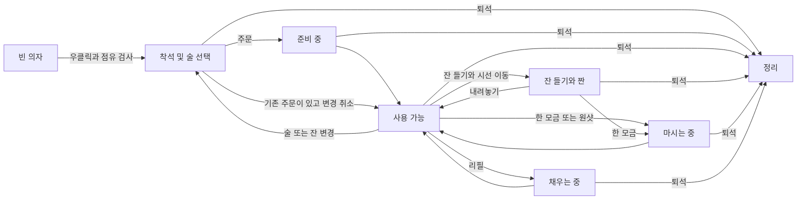

# 짠 Minecraft 포팅 구현 명세

작성일: 2026-11-14  
수정일: 2026-11-15  
상태: 구현 제안  
기본 환경: 기존 Minecraft 모드 확장, 해당 모드의 대형 커스텀 블록과 설치 홀로그램 시스템

플레이어가 월드에 설치된 여러 종류의 테이블에 앉아 술과 잔을 고르고, 잔을 움직여 다른 사람과 부딪히고, 한 모금 또는 원샷으로 마시는 기능을 구현한다. 테이블마다 독립적으로 동작하며, 같은 공간에 여러 테이블을 설치할 수 있어야 한다.

**테이블은 복셀로 구성된 대형 커스텀 블록으로 기존 모드에 추가한다. 설치할 때 해당 모드의 다른 대형 블록과 동일한 홀로그램으로 위치·회전·설치 가능 여부를 표시하고, 기존 설치 처리 경로를 재사용한다.** 서버는 좌석·잔·음주·충돌을 확정하고 클라이언트는 모델·입력·화면·연출을 담당한다. 이 문서에서 ‘유지’는 원본 놀이 규칙과 결과의 일치를, ‘변경’은 Minecraft에 맞춘 의도적인 차이를 뜻한다.

대상 Minecraft 버전, 모드 로더, 언어와 빌드 방식은 추가 개발할 기존 모드의 구성을 따른다. 현재 작업 폴더에는 웹 원본만 있으므로 대상 모드의 구체적인 클래스·API 이름은 확정하지 않는다. 아래 `TableDefinition`, `PlacementPlan` 등의 이름은 설계 개념이며, 구현 시 기존 모드의 대응 타입에 연결한다. 별도 모드 로더나 서버 플랫폼으로의 전환은 범위에 포함하지 않는다.

테이블 설치부터 파괴·회수·저장·재접속까지 기존 대형 블록의 생명주기를 따른다. 클라이언트와 서버 양쪽에 해당 기능이 포함된 모드 버전이 설치되어 있어야 한다.

## 1 구현 범위

### 필수 기능과 원본 대응

| 기능 | 원본에서 확인한 동작 | Minecraft 구현 기준 |
| --- | --- | --- |
| 테이블 | 바 2인, 사각 4인, 원형 8인, 긴 테이블 12인, 큰 원탁 12인, ㄷ자 16인 | 복셀 커스텀 블록 6종. 종류별 여러 인스턴스 지원 |
| 설치 미리보기 | 웹 원본에는 없음 | 기존 대형 블록과 동일한 홀로그램·회전·설치 가능 판정·확정 처리 |
| 착석 | 방에 입장하며 빈자리 선택 | 월드의 빈 의자 우클릭으로 해당 자리 착석 |
| 술 선택 | 7개 분류, 64종, 일부 술은 브랜드 선택 | 데이터 목록 유지. 기존 모드의 화면 구성 방식으로 선택 |
| 잔 선택 | 공개된 잔 22종, 추천 잔 외 다른 잔도 선택 가능 | 22종과 자유 조합 유지. 내부 연출용 `dropshot`은 메뉴에서 제외 |
| 짠 | 잔 위치·높이·상대속도로 실제 접촉 판정 | 서버가 가상 잔의 위치와 충돌을 계산 |
| 짠 연출 | 재질별 소리, 충돌 강도별 소리와 튐, 횟수 기록 | 모드 음향, 파티클, 짧은 반동, 개인별 횟수 |
| 한 모금 | 일반 잔은 가득 찬 양의 34%씩 감소 | 동일한 잔량 규칙 |
| 작은 잔 | 소주잔·샷잔 또는 `drink.shot`이면 한 모금도 전량 소비 | 동일하게 처리 |
| 원샷 | 남은 양 전부 소비 | 메뉴의 원샷 버튼과 명령어 제공 |
| 리필 | 같은 술을 남은 양부터 가득 채움 | 술·브랜드·잔 유지, 따르는 연출 후 충전 |
| 취기 | 소비량·잔 용량·도수에 비례, 시간이 지나면 감소 | 계산과 단계 유지, 시각 표현은 Minecraft 방식으로 변경 |
| 건배사 | ‘짠!’, ‘건배!’ 등 고정 문구 | 같은 테이블에 보이는 짧은 말풍선 |
| 동기화 | 같은 방의 술·잔·움직임·행동 공유 | 같은 월드에서 주변 플레이어가 동일한 결과를 관찰 |

원본 근거: [tables.js](../public/js/tables.js), [data.js](../public/js/data.js), [glass.js](../public/js/glass.js), [game.js](../public/js/game.js), [main.js](../public/js/main.js), [server.js](../server.js).

### 이번 버전에서 제외할 기능

안주와 뺏어 먹기, 해장 아이템, 바텐더 AI와 혼자 놀기, 술집 배경 전체, 음악·YouTube 신청곡, 영수증과 가상 가격, 이모지 검색, 웹 초대 링크, 별도 경제 시스템 연동은 제외한다. 술과 리필은 무료이며 수량 제한을 두지 않는다. 테이블 설치 아이템이나 설계도는 기존 모드의 획득·설치 체계에 등록하고, 새 제작 레시피와 가격의 밸런스 결정은 후속 작업으로 둔다.

브랜드별 병 색과 이름은 가져오되, 모든 칵테일의 조리 과정·손가락 동작·얼음 물리를 그대로 재현하는 것은 제외한다. 술의 이름·색·도수·잔량·선택 결과는 유지하고 제조 과정은 공통 연출로 표현한다.

### 원본과 의도적으로 달라지는 부분

| 항목 | 변경 사항과 이유 |
| --- | --- |
| 잔 조작 | ‘잔 들기 동작 → 시선으로 이동 → 내려놓기’를 기본으로 하며 모드의 재설정 가능한 입력에 연결 |
| 원샷 입력 | 한 모금·원샷 버튼 제공. 원본의 0.85초 누르기는 클라이언트 입력으로 함께 지원 |
| 테이블 자동 확장 | 만석이면 다른 테이블 안내. 설치된 구조물을 자동으로 늘리거나 모두를 이동시키지 않음 |
| 취기 화면 | 이름표 색·잔 떨림·딸꾹질로 표현. 원본의 화면 롤·블러·붉은 가장자리 효과는 재현 대상에서 제외 |
| 퇴석 후 잔 | 잔과 진행 중 연출을 정리. 다음 착석 시 이전 선택을 기본값으로 제안하고 주문 확정 후 새로 준비 |
| 조작 주체 | 자신의 잔만 이동·마시기·리필 가능. 다른 사람의 잔과 접촉하는 것은 가능 |

잔은 클라이언트에서 렌더링하는 월드 오브젝트로 구현한다. 기존 모드에 손·팔 애니메이션이나 카메라 효과 공통 기능이 있으면 연동하되, 원본의 모든 손가락·후처리 재현을 필수 조건으로 확대하지 않는다. 설치 입력은 기존 대형 블록 조작을 그대로 사용하며, 착석 후 입력만 술자리 기능으로 전환한다.

## 2 플레이 흐름과 조작

1. 기존 대형 블록과 같은 방식으로 테이블 설치 아이템·설계도를 선택하고, 홀로그램으로 위치와 설치 가능 여부를 확인해 설치한다. 설치된 테이블에는 종류와 `현재 인원 / 정원`이 보인다.
2. 빈 의자를 우클릭하면 그 자리에 앉고 술 선택 메뉴가 열린다.
3. 술, 브랜드, 잔을 고르고 ‘주문’을 누르면 자기 앞에서 잔이 준비된다.
4. 잔 들기 동작으로 잔을 들고 시선을 움직여 다른 사람의 잔과 부딪힌다.
5. 왼쪽 클릭으로 한 모금 마시거나, 자기 자리 메뉴에서 원샷·리필·술 변경을 선택한다.
6. Shift로 일어나면 자리가 즉시 비고 잔이 정리된다.

잔 들기 입력은 기존 모드의 보조 상호작용에 연결하거나 재설정 가능한 전용 키로 등록한다. F는 충돌이 없을 때의 기본 후보이며 고정 요구사항이 아니다. 퇴석은 모드의 기존 내리기 동작을 따른다. 화면 안내에는 실제 설정된 키를 표시한다.

| 상황 | 입력 | 결과 |
| --- | --- | --- |
| 설치 아이템·설계도 선택 | 기존 모드의 조준·회전·확정·취소 입력 | 공통 홀로그램과 설치 흐름 |
| 미착석 | 빈 의자 우클릭 | 착석 |
| 착석 | 자기 자리의 잔 받침 우클릭 | 개인 메뉴 열기 |
| 착석 | 잔 들기 동작, F는 기본 후보 | 잔 들기 또는 내려놓기 |
| 잔을 든 상태 | 시선 이동 | 테이블 위에서 잔 이동 |
| 착석하고 메뉴가 닫힌 상태 | 주손 왼쪽 클릭 | 한 모금. 진행 중 동작이 있으면 무시 |
| 개인 메뉴 | 원샷 | 남은 양 전부 마시기 |
| 개인 메뉴 | 마시기 버튼을 0.85초 누름 | 원샷. 그 전에 놓으면 한 모금 |
| 개인 메뉴 | 채우기 | 현재 술 리필 |
| 개인 메뉴 | 술과 잔 변경 | 선택 화면 열기 |
| 개인 메뉴 | 건배사 | 고정 문구 선택 |
| 착석 | 내리기, 기본 Shift | 퇴석 |
| 어디서나 | `/jjan menu`, `/jjan leave` | 메뉴와 퇴석 보조 경로 |

잔 받침은 잔이 이동해도 원래 자리에 남는 클릭 영역이다. 다른 사람의 받침을 클릭해서 그 사람의 메뉴를 열 수 없다. 기본 인벤토리·핫바를 임시 아이템으로 교체하지 않는다.

착석 중 전용 입력이 활성화된 경우에만 겹치는 기본 동작을 소비한다. 왼쪽 클릭을 한 모금으로 사용하므로 해당 세션 중 블록 파괴와 공격도 취소한다. 메뉴가 열려 있거나 퇴석 중이면 월드 클릭을 음주로 처리하지 않는다. Shift는 퇴석에만 사용하여 원샷 입력과 충돌하지 않게 한다. 설치 홀로그램 조작과 착석 입력은 동시에 활성화하지 않는다.

클라이언트는 입력 의도를 기존 모드의 네트워크 경로로 전송한다. 서버는 세션·권한·행동 잠금·중복 요청을 확인해 확정한다. 길게 누르기는 클라이언트의 누름·해제·포커스 상실 상태로 처리하며, 원샷이 발동한 뒤 해제될 때 한 모금이 추가로 발생하지 않게 한다. 화면을 닫거나 포커스를 잃으면 아직 실행하지 않은 입력을 취소한다.

### 메뉴 구성

술 선택 화면은 기존 모드의 화면·위젯 체계를 사용한다. 상단은 7개 분류, 가운데는 해당 분류의 술, 하단은 이전·다음 페이지와 주문 요약으로 구성한다. 술을 선택하면 추천 잔을 기본값으로 설정하고, 브랜드와 잔은 별도 선택 화면에서 변경한다.

주문 요약에는 술 이름, 브랜드, 잔 이름, 게임 내 도수를 표시한다. 선택 화면을 닫기만 하면 기존 잔을 유지하고, ‘주문’을 눌러야 교체한다. 잔 변경도 새 주문으로 취급한다. 남아 있던 술은 버려지고 새 술을 준비하지만 버린 양은 취기에 더하지 않는다.

개인 메뉴에는 한 모금·원샷·채우기·술과 잔 변경·건배사를 배치하고 현재 잔량과 취기를 표시한다. 준비 중에는 음주·리필·변경을 비활성화한다. 기존 모드의 HUD는 `라거 · 파인트 | 66% | 기분 좋음 | [설정된 키] 잔 들기`처럼 현재 상태와 가능한 조작을 보여준다.

술 선택 아이콘은 화면 위젯이며 플레이어 인벤토리에 실제 아이템을 발급하지 않는다. 선택 확정은 서버의 카탈로그 검증을 거치고 기본 인벤토리를 보존한다. 기존 모드가 슬롯 기반 메뉴를 사용하는 경우에는 클릭·드래그·숫자키·Shift 이동 등 모든 경로의 아이콘 반출을 차단한다.

## 3 테이블과 착석

### 테이블 종류

| definitionId | 종류 | 좌석 수 | 배치 | 초기 제작 공간 제안 |
| --- | --- | ---: | --- | --- |
| `bar` | 바 테이블 | 2 | 나란히 | 5 × 4블록 |
| `square` | 사각 테이블 | 4 | 네 방향 | 5 × 5블록 |
| `round` | 원형 테이블 | 8 | 원주를 따라 배치 | 7 × 7블록 |
| `long` | 긴 테이블 | 12 | 긴 변 양쪽에 6명씩 | 11 × 5블록 |
| `biground` | 큰 원탁 | 12 | 원주를 따라 배치 | 9 × 9블록 |
| `ushape` | ㄷ자 단체석 | 16 | 양팔 4명씩, 앞쪽 8명 | 11 × 9블록 |

제작 공간은 의자를 포함한 초기 설계값이며 바깥에 1블록 이상의 통로를 추가 확보한다. 최종 크기는 16명 착석 시 몸·잔·받침이 겹치지 않는지 확인한 뒤 확정한다. 원본의 복셀 좌표를 그대로 Minecraft 블록 좌표로 사용하지 않는다.

테이블은 `TableDefinition`과 `TableInstance`로 나눈다. 정의는 복셀 외형·점유 셀·좌석·잔 이동 영역을 포함하고, 인스턴스는 차원 식별자·기준 블록 좌표·회전·점유 상태를 가진다. 같은 정의를 여러 번 설치해도 서로 다른 테이블이다.

모든 좌표는 테이블 기준의 로컬 좌표로 저장하고 설치 회전을 적용한다. 각 좌석에는 `seatAnchor`, `lookYaw`, `glassHome`, `menuAnchor`, `exitCandidates`를 정의한다. 의자뿐 아니라 잔 받침과 퇴석 위치도 같이 회전해야 한다.

### 복셀 커스텀 블록 구성

테이블 6종은 기존 모드의 대형 커스텀 블록 기반 타입과 등록 체계를 확장한다. 상판·다리·의자를 복셀 형태의 작은 직육면체로 모델링하고, 원형은 복셀 계단형 윤곽으로 표현한다. 모델 해상도·텍스처·재질·외곽선 스타일은 기존 대형 블록에 맞춘다. 복셀 한 조각마다 Minecraft 블록이나 엔티티를 만들지 않는다.

기본 배치 단위는 상판·다리·좌석이 포함된 테이블 세트 하나다. 여러 블록 공간을 차지하더라도 설치 아이템 1개와 논리 인스턴스 1개로 관리한다. 기존 모드의 기준 블록·부속 블록 또는 공간 점유 방식에 좌석 정보를 추가하고, 그 방식으로 상호작용을 기준 인스턴스에 전달한다. 별도 공간 점유 체계를 중복 구현하지 않는다.

| 정의 | 용도 |
| --- | --- |
| `voxelModel` | 실제 설치 외형과 홀로그램에서 공유할 모델 |
| `occupiedCells` | 설치·파괴·저장에 사용하는 논리 점유 셀. 기존 모드의 대형 블록 표현을 따름 |
| `collisionShapes` | 상판·다리·의자의 물리 충돌 모양 |
| `selectionShapes` | 블록 선택과 상호작용 레이 판정 |
| `supportRules` | 바닥과 지지면 요구사항 |
| `seatClearances` | 각 좌석의 몸·머리 공간과 퇴석 후보 |
| `seats` | 좌석 방향·잔 받침·메뉴 위치 |
| `toastRegion` | 잔 이동 허용 영역 |

복셀 외형, 물리 충돌, 설치 점유 범위는 용도가 다르다. 하나의 큰 직육면체를 세 용도에 공통 적용해 ㄷ자 중앙이나 다리 사이를 모두 막지 않는다. 기존 시스템이 셀 단위 점유를 사용한다면 그 제약 안에서 점유 셀과 셀 내부 충돌을 구분한다. 회전 시 위 데이터 전체에 같은 변환을 적용한다.

### 기존 설치 홀로그램 연동

**완료 기준은 기존 대형 블록과 테이블을 번갈아 선택했을 때 설치 조작과 판정 표현이 동일한 것이다.** 같은 설치 도구·아이템 처리, 홀로그램 렌더러, 배치 판정기, 서버 설치 실행 경로에 테이블 정의를 등록한다. 공통 확장점이 부족하면 기존 경로에 최소한의 확장점을 추가한다.

1. 기존 방식으로 설치 아이템이나 설계도를 선택하면 테이블 전체와 의자 방향을 홀로그램으로 표시한다.
2. 기존 조준·스냅·회전 규칙으로 기준 위치와 방향을 계산한다. 지원 회전 각도와 회전키도 기존 블록과 같다.
3. 점유 범위, 충돌, 지지면, 좌석 공간과 기존 공통 조건으로 설치 가능 여부를 갱신한다.
4. 가능·불가 색, 투명도, 외곽선, 막힌 위치 강조, 사유 표시, 소리는 기존 블록의 표현을 따른다. 테이블 전용 색 체계를 새로 정의하지 않는다.
5. 기존 설치 확정 입력으로 서버에 요청한다. 서버가 현재 월드 상태로 다시 검사한 뒤 전체 구조를 확정한다.
6. 취소·선택 아이템 변경·화면 종료 시 홀로그램을 즉시 정리한다. 미리보기만으로 월드 블록, 좌석, 저장 데이터 또는 드롭을 만들지 않는다.

기존 대형 블록이 직접 우클릭으로 배치된다면 테이블도 같은 입력을 사용하고, 기존 시스템에 확정 단계가 있다면 같은 단계를 사용한다. 별도 설치 명령어나 테이블 전용 확인창을 정상 설치 흐름에 요구하지 않는다.

### 설치 판정과 서버 확정

클라이언트 미리보기와 서버 확정은 동일한 정의와 공통 판정 로직을 사용한다. 서버에만 있는 권한·보호 정보는 기존 검증 응답 경로로 보완한다. 아직 검증되지 않았거나 필요한 청크가 로드되지 않았다면 기존 시스템의 미확정·불가 상태로 표시하고 설치 성공으로 간주하지 않는다.

| 검사 | 기준 |
| --- | --- |
| 위치와 회전 | 기존 스냅·회전·설치 거리 규칙 적용 |
| 공간 | 회전된 전체 점유 셀 검사. 블록·다른 대형 블록·설치 예약과 충돌 여부 확인 |
| 교체와 유체 | 공기·풀·물 등 설치 가능한 대상은 기존 판정기를 따름 |
| 지지면 | 정의에 지정한 다리·지지점의 바닥 조건 검사 |
| 플레이어와 엔티티 | 기존 공통 충돌 규칙과 좌석 몸·머리 공간 검사 |
| 좌석 접근 | 모든 좌석에 사용 가능한 공간과 최소 하나의 안전한 퇴석 후보 확보 |
| 경계와 권한 | 높이·월드 경계·보호 구역·플레이어 권한·아이템 수량 검사 |
| 청크 | 기존 시스템의 여러 청크에 걸친 설치 규칙 적용. 일부만 설치하지 않음 |

설치 위치·방향·정의 버전으로 `PlacementPlan`을 만들고 홀로그램과 확정 요청에 공유한다. 설치 시에는 아이템 선택·수량·거리·현재 월드 조건을 서버가 재검사한다. 미리보기 이후 다른 플레이어가 블록을 놓았으면 실패 사유를 반환하고 새 판정을 표시한다.

검증 응답은 해당 요청 ID·위치·회전·정의 버전이 현재 미리보기와 일치할 때만 반영한다. 조준 위치를 바꾸거나 취소한 뒤 도착한 오래된 ‘설치 가능’ 응답이 새 홀로그램의 상태를 덮어쓰지 않게 한다. 클라이언트가 보낸 점유 셀 목록을 신뢰하지 않고 서버의 정의에서 다시 계산한다.

서버 설치는 기존 대형 블록의 원자적 배치 절차를 따른다. 모든 점유 셀과 기준 상태를 확정한 뒤 일반 모드에서는 아이템을 정확히 한 번 소비하고, 크리에이티브는 기존 규칙을 따른다. 실패하면 자신이 변경한 셀·예약·데이터만 되돌리고 아이템을 소비하지 않는다. 중복 요청이나 같은 공간에 대한 동시 설치는 서버에서 하나만 성공시킨다.

### 착석 규칙

- 한 플레이어는 한 자리만 점유할 수 있고, 한 자리는 한 플레이어만 사용할 수 있다.
- 의자 상호작용 거리는 기존 모드의 블록 상호작용 도달거리를 따른다. 같은 차원, 시야가 막히지 않음, 사용 권한, 구조가 정상 로드된 상태인지 함께 검사한다.
- 이미 다른 탈것에 타고 있거나 잠자기·관전 상태이면 착석을 거절한다. 기존 탈것에서 강제로 내리지 않는다.
- 자리 예약 → 좌석 엔티티 준비 → 플레이어 탑승 → 세션 생성 순서로 처리한다. 실패하면 예약과 생성 엔티티를 되돌린다.
- 동시에 같은 의자를 클릭하면 서버에서 먼저 확정한 한 명만 앉는다. 나머지는 ‘이미 사용 중인 자리입니다’를 받는다.
- 실제 착석은 기존 모드의 의자·탑승 기능이 있으면 재사용한다. 없으면 해당 모드의 방식으로 좌석 엔티티와 앉기 포즈를 구현한다. 좌석은 테이블 기준 인스턴스와 좌석 번호에 연결하고 앉은 높이·시선·내리기를 초기 시제품에서 검증한다.
- 고개는 자유롭게 돌릴 수 있다. 이동키로 의자가 밀리지 않는다.
- 만석인 테이블은 입장을 거절한다. 최대 인원은 서버 전체 제한이 아니라 각 인스턴스의 좌석 수다.

### 퇴석과 예외

내리기 입력, `/jjan leave`, 접속 종료, 사망, 다른 차원으로 이동, 외부 텔레포트, 좌석 소실, 테이블 파괴·회수, 구조 언로드, 서버 종료는 모두 같은 퇴석 정리 함수를 거친다. 기존 모드의 파괴·이동 처리에 진입할 때도 먼저 세션을 정리한다.

정리 순서는 세션 무효화 → 메뉴 닫기 → 동작 취소 → 잔·임시 엔티티 제거 → 점유 해제 → 탑승 해제다. 일반 퇴석은 출구 후보의 발밑과 머리 공간을 검사해 안전한 위치로 보낸다. 출구가 모두 막혔으면 착석 전 안전 위치, 그다음 월드 스폰을 사용한다. 외부 텔레포트·사망·접속 종료에서는 목적지를 덮어쓰지 않는다.

연결이 끊기면 좌석을 즉시 반환한다. 재접속 시 자동으로 다시 앉히지 않으며, 다른 플레이어가 차지한 자리를 되찾지 않는다. 빈자리에 남아 있는 이전 플레이어의 잔도 제거한다.

## 4 술과 잔 데이터

최종 1차 릴리스의 카탈로그는 원본의 술 64종·분류 7종·공개 잔 22종이다. 개발용 최소 시제품에서는 라거·소주·레드 와인·막걸리·하이볼·콜라로 시작하되, 그 축소 목록을 최종 범위로 간주하지 않는다.

| 데이터 | 필수 필드 |
| --- | --- |
| `DrinkDefinition` | id, category, name, description, abv, defaultGlassId, shot, color, visualFillHeight, preparationKind, effectFlags, variants |
| `GlassDefinition` | id, name, material, modelKey, contactRadius, contactLow, contactHigh, contactMid |
| `DrinkGlassProfile` | drinkId, variantId, glassId, servingCapacityMl, 액체 모델 설정 |
| `VariantDefinition` | id, name, 병 모델·색, 원본의 음료 속성 변경분 |

`DrinkGlassProfile`의 용량은 잔만으로 결정되지 않는다. 원본은 술별 `drink.fill`과 잔의 내부 형상을 함께 사용해 1회 제공량을 계산한다. 따라서 ‘소주잔은 무조건 50ml’ 같은 새 값으로 대체하지 않는다.

원본 `drink.fill`은 잔 내부의 **초기 액면 높이 설정**이다. 런타임의 `fill`은 제공된 양의 **남은 비율 0~1**이다. 예를 들어 라거의 `drink.fill = 0.8`이어도 제공 완료 후 런타임 `fill`은 1이다.

### 데이터 이전 방법

Node 기반 빌드 도구에서 `data.js`의 정의를 불러오고, `resolveDrink`의 브랜드 변경분을 반영한 뒤 JSON으로 내보낸다. 용량은 `voxel.js`의 `buildShape`와 `glass.js`의 아래 계산을 사용한다.

```text
cavityTop = cavityStart + (shapeHeight - cavityStart) × drink.fill
servingCapacityMl = Σ(cavityCols[y].length / 2)
                   for cavityStart ≤ y < floor(cavityTop)
```

모드 런타임에서는 생성된 순수 데이터와 모드 자산을 로드한다. 잔의 `paint` 같은 함수는 JSON으로 직렬화하지 않고 모델 제작·텍스처 생성 단계에서 처리한다. 자료의 의미상 ID는 원본과 동일하게 유지하고 실제 등록 키는 기존 모드의 이름 공간 규칙을 따른다.

술·브랜드·잔 ID, 범주, 수치 범위와 참조를 시작 시 검증한다. 잘못된 설정은 오류 위치와 함께 거절하고 이전 정상 설정을 유지한다. 브랜드에 명시된 변경분 이외의 도수는 외부 실제 상품 정보로 추정하지 않는다.

아래는 현재 원본의 기본 브랜드·추천 잔 조합으로 계산한 검증값이다. 모델을 Minecraft 크기로 확대해도 이 게임 내 제공량은 바뀌지 않는다.

| 술 ID | 잔 ID | 제공량 | 게임 내 도수 |
| --- | --- | ---: | ---: |
| `lager` | `pint` | 264ml | 5% |
| `soju` | `soju` | 52ml | 16.5% |
| `red` | `wine` | 104ml | 13.5% |
| `makgeolli` | `bowl` | 228ml | 6% |
| `highball` | `highball` | 224ml | 9% |
| `cola` | `highball` | 208ml | 0% |

## 5 상태와 동작 규칙

### 상태 모델

빈 잔과 손에 든 잔은 동시에 성립할 수 있으므로 하나의 열거형에 섞지 않는다.

| 구분 | 상태 |
| --- | --- |
| 좌석 | `FREE`, `RESERVED`, `OCCUPIED` |
| 세션 | `SELECTING`, `ACTIVE`, `LEAVING`, `CLOSED` |
| 잔 위치 | `RESTING`, `RAISED`, `RETURNING` |
| 잔 동작 | `IDLE`, `PREPARING`, `SIPPING`, `CHUGGING`, `REFILLING` |
| 잔량 | `fill` 0~1. 비어 있음은 `fill < 0.02`로 판정 |



행동마다 `sessionId`, `actionId`, `stateVersion`을 부여한다. 서버가 시작을 확정할 때 잔량·취기·통계를 한 번만 변경하고, 애니메이션은 그 결과를 표현한다. 예약된 연출 콜백은 세션과 actionId가 여전히 일치할 때만 실행한다.

처음 착석한 뒤 아직 주문하지 않았다면 잔 들기·음주·리필은 사용할 수 없다. 메뉴를 닫아도 자동 주문하지 않는다. 기존 잔이 있는 상태에서 변경 메뉴를 닫으면 원래 `ACTIVE` 상태와 잔으로 돌아간다.

준비·음주·리필 중에는 다른 음주 동작, 술 변경, 잔 이동을 시작할 수 없다. 퇴석은 언제든 가능하다. 들고 있던 잔으로 음주를 시작하면 이동을 멈추고 음주 연출 후 제자리로 내려놓는다. 메뉴가 열리면 잔을 제자리로 돌려놓고, 그 복귀 경로에서는 짠을 발생시키지 않는다.

### 한 모금과 원샷

일반 한 모금은 `after = max(0, before - 0.34)`다. 남은 양의 34%가 아니라 최초 제공량의 34%이므로 가득 찬 잔은 `1 → 0.66 → 0.32 → 0`으로 변한다.

`drink.shot = true`, 잔 ID `soju`, 잔 ID `shot` 중 하나라도 해당하면 한 모금으로 전량 소비한다. 원샷은 모든 잔에서 전량 소비한다. 원본의 불붙은 술은 빨대 음주가 전량을 소비하므로 해당 데이터도 같은 결과를 유지하고 연출만 단순화한다.

```text
consumedRatio = before - after
consumedMl = consumedRatio × servingCapacityMl
alcoholMl = consumedMl × abv / 100
```

검증 예시로 기본 라거·파인트의 첫 한 모금은 89.76ml, 순수 알코올에 해당하는 게임 수치는 4.488ml다. 시간 감소를 제외한 취기 목표 증가량은 0.0748이어야 한다.

빈 잔 또는 다른 동작 중에는 음주를 거절한다. 일반 한 모금 연출은 원본의 1.55초, 원샷은 `1.55 + before`초를 기준으로 틱 단위에 올림한다. 상태 차감은 시작 때 확정하지만 액면은 연출 시간 동안 이전 값에서 새 값으로 내려간다. 음주 도중 퇴석해도 이미 확정된 취기는 되돌리지 않는다.

마시는 동안 잔이 입 근처로 올라가고 기울며 꿀꺽 소리가 난다. 이 움직임은 손·팔의 독자적인 애니메이션을 요구하지 않는다. 체력·허기·일반 포션 효과는 변경하지 않는다.

### 리필과 변경

리필은 원본 UI와 같이 `fill > 0.97`이면 비활성화한다. 그 외에는 현재 술·브랜드·잔을 유지하고 부족한 양만 채운다. 서버가 리필을 수락할 때 목표 잔량 1을 확정하고, 준비 연출이 끝날 때까지 추가 입력을 잠근다. 리필 자체는 취기와 마신 양을 증가시키지 않는다.

술 변경은 메뉴의 주문 확정 시에만 적용한다. 기존 잔을 정리하고 새 조합으로 `PREPARING`을 시작한다. 자기 잔 하나만 변경하며 다른 사람의 술은 바꾸지 않는다.

## 6 짠 판정과 잔 이동

### 시선으로 잔 이동

서버는 착석한 플레이어의 눈 위치와 시선 방향으로 레이를 만들고, 테이블에 설정된 `toastPlaneY`와 만나는 점을 목표로 사용한다. 이 평면은 앉은 눈높이보다 낮게 둔다. 잔마다 `contactMid`가 평면에 오도록 높이를 보정하여 키가 다른 잔도 부딪힐 수 있게 한다.

레이가 평면과 거의 평행하거나 뒤쪽에서 만나면 마지막 유효 목표를 유지한다. 목표는 자기 테이블의 `toastRegion`과 최대 거리 안으로 제한한다. 실제 엔티티 우클릭 도달거리를 늘리는 기능이 아니라, 이미 소유한 잔의 이동 목표를 서버가 계산하는 방식이다.

시선이 급변해도 잔을 순간이동시키지 않는다. 기본 최대 이동속도 2.4블록/초와 감쇠를 적용한다. 이는 Minecraft용 초기 조정값이다. 클라이언트에는 짧은 보간으로 이동을 표시하고, 판정은 서버의 계산 위치로 한다.

원형은 원판, 사각·긴 테이블은 직사각형을 이동 영역으로 사용한다. ㄷ자는 세 직사각형의 합집합으로 정의한다. ㄷ자 빈 중앙을 가로지르는 보간은 허용하지 않고 연결된 팔·앞쪽 경로를 따라 이동한다. 같은 테이블의 먼 자리와도 잔을 만나게 할 수 있도록 전체 영역을 공유하며, 이를 실제 팔의 길이로 제한하지 않는다.

상판 외 다른 블록에 막히는 구간과 테이블 장식 장애물은 통과하지 않는다. 목표점뿐 아니라 이동 구간도 검사한다. ㄷ자 경로 이동과 같은 긴 이동에서도 벽·다른 테이블로 빠져나가지 않아야 한다.

### 충돌 성립 조건

다음 조건을 모두 만족할 때 짠 이벤트를 만든다.

1. 서로 다른 플레이어의 잔이며 같은 `tableInstanceId`에 속한다.
2. 두 세션 모두 유효하고 준비·음주·리필·복귀 애니메이션 중이 아니다.
3. 적어도 한 잔은 플레이어가 들고 있다.
4. 잔 몸통의 수직 구간이 겹치고 수평 충돌 반지름이 접촉한다.
5. 두 잔이 접근하는 상대속도가 최소값을 넘는다.
6. 해당 잔 쌍의 재접촉 조건과 소리 쿨다운을 만족한다.

빈 잔도 짠을 할 수 있다. 같은 테이블에 앉아 있다는 이유만으로 자동 건배하지 않으며, 서로 닿지 않은 잔에는 이벤트를 보내지 않는다. 3명 이상이 모으면 실제 접촉한 잔 쌍마다 처리한다. A가 B와 C에 한 번씩 부딪히면 A의 횟수는 2회다.

원본처럼 수평 원형 충돌체와 수직 구간을 사용한다. 한 틱 사이에 작은 잔을 통과하지 않도록 이동 구간 충돌 검사 또는 물리 서브스텝을 적용한다. 접촉 시 분리 보정과 작은 반동을 주되 플레이어 몸에는 넉백을 주지 않는다.

### 강도와 중복 방지

속도 단위는 블록/초다. 초기값은 원본의 cm 단위 상수를 환산한 다음과 같고, 실제 조작감은 PoC에서 조정한다.

```text
minApproachSpeed = 0.10
strength = clamp((approachSpeed - 0.06) / 1.70, 0.05, 1.0)
soundCooldown = 3 ticks          # 원본 140ms에 대응하는 초기값
countCooldown = 13 ticks         # 원본 650ms
soundRearmGap = 0.02 blocks
countRearmGap = 0.06 blocks
```

키는 두 잔의 세션 ID를 정렬한 쌍으로 만든다. 접촉이 유지되는 동안에는 반복 재생하지 않는다. 소리는 반지름 합보다 `soundRearmGap`만큼 떨어져야 다시 허용하고, 횟수는 `countRearmGap`만큼 떨어져야 다시 센다. 수직 구간이 완전히 떨어져도 재접촉 가능 상태로 돌아간다. 시간 조건과 분리 조건을 모두 적용한다.

서버는 `clinkId` 하나를 발급해 두 플레이어의 개인 짠 횟수를 각각 1 증가시킨다. 테이블 합계는 같은 충돌을 1회로 기록한다. 소리 재생과 통계 증가를 별도 단계로 두어 반동으로 재접촉해도 횟수가 중복되지 않게 한다.

잔 재질 `glass`, `thick`, `crystal`, `metal`, `ceramic`, `wood`에 맞는 소리를 사용하고 두 잔의 재질·크기·충돌 강도를 반영한다. 강한 충돌은 파티클과 거품 반응을 키운다. 원본의 `hit`·`splash`는 튐 연출에서 잔량을 차감하지 않으므로 기본안도 술을 차감하지 않는다. 액체가 비어 있으면 액체 파티클은 만들지 않는다.

## 7 취기

원본의 게임 수치를 유지한다. 현실의 혈중알코올농도나 실제 취한 정도를 나타내는 값으로 사용하지 않는다.

```text
target = min(1.6, target + alcoholMl / 60)
target = max(0, target - 0.0035 × elapsedSeconds)
displayed는 target을 향해 상승 시 초당 0.06, 하강 시 초당 0.12 이동
```

| displayed 범위 | 표시 |
| --- | --- |
| 0 이상 0.1 미만 | 말짱 |
| 0.1 이상 0.3 미만 | 기분 좋음 |
| 0.3 이상 0.55 미만 | 알딸딸 |
| 0.55 이상 0.8 미만 | 어질어질 |
| 0.8 이상 | 만취 |

술을 바꾸거나 리필하거나 자리를 옮겨도 취기가 초기화되지 않는다. 무알코올 음료는 취기를 증가시키지 않으며, 음료 자체에 별도의 해장 효과를 추가하지 않는다.

화면에는 모드 HUD의 단계, 잔의 작은 떨림, 클라이언트 이름표 색, 원본 기준 `displayed > 0.5`에서의 간헐적 딸꾹질을 사용한다. 잔 떨림은 서버의 이동에도 작은 범위로 반영한다. 시각 효과를 끄는 개인 설정은 떨림·파티클 표시를 줄이되 술 소비량과 취기 수치를 바꾸지 않는다.

접속 종료 시 `target`과 마지막 계산 시각을 저장한다. 재접속하면 오프라인 경과 시간에 같은 감소율을 적용한다. 서버 시계가 뒤로 이동했을 때 음수 경과 시간을 적용하지 않는다. 퇴석 후에도 취기가 남아 있는 온라인 플레이어는 감소 계산을 계속한다.

## 8 기존 모드 연결과 서버 구조

기존 `server.js`는 웹 클라이언트가 계산한 잔 위치·잔량·취기를 전달하는 부분이 크다. Minecraft 버전에서는 모드 서버 측에서 위치·행동 가능 여부·소비량·충돌·취기를 계산한다. 클라이언트는 입력 의도를 보내고 확정 상태를 받아 표시한다.

### 기존 모드에서 재사용할 연결 지점

| 기존 기능 | 테이블 확장 내용 |
| --- | --- |
| 대형 블록 등록과 기반 타입 | 테이블 6종과 각 복셀 모델·좌석 정의 등록 |
| 설치 아이템·설계도 | 기존 획득·선택·설치 진입 흐름에 추가 |
| 홀로그램 렌더러 | 같은 위치 변환·색·투명도 규칙으로 테이블 모델 표시 |
| 배치 판정기와 설치 실행기 | 공통 조건에 테이블 점유 셀·지지면·좌석 여유 공간 제공 |
| 기준 블록과 부속 구조 | 테이블의 소유 관계, 파괴·회수, 부분 청크 로드 처리 |
| 좌석과 플레이어 포즈 | 좌석 번호·방향·안전한 퇴석 위치 연결 |
| 화면·입력·네트워크 | 술 선택, 잔 이동, 음주 요청과 상태 동기화 |
| 저장·버전 이전 | 테이블 정의 버전, 플레이어 선호와 취기 저장 |

실제 구현 전에는 대상 모드에서 대형 블록 하나의 설치·홀로그램·파괴·저장 경로를 추적해 위 표에 대응하는 파일과 타입을 기록한다. 아래 기능 단위는 책임 구분이며 기존 모드에 같은 역할이 있으면 그 안에 확장한다.

| 모듈 | 책임 |
| --- | --- |
| `TableService` | 기존 대형 블록 인스턴스와 술자리 상태 연결, 좌표 변환 |
| `TablePlacementAdapter` | 공통 홀로그램·배치 판정·설치 실행기에 테이블 정의 전달 |
| `SeatService` | 자리 예약, 탑승, 점유와 퇴석 |
| `SessionService` | 플레이어와 테이블 연결, 세션 수명 |
| `CatalogService` | 술·브랜드·잔 데이터 검증과 조회 |
| `DrinkService` | 주문, 한 모금, 원샷, 리필, 취기 증가 |
| `GlassMotionSystem` | 시선 목표, 이동 제한, 반동, 충돌 쌍 계산 |
| `IntoxicationService` | 시간 감소, 표시 단계와 저장 |
| `MenuService` | 개인 메뉴와 선택 화면 |
| `RenderService` | 커스텀 블록과 잔 모델·화면·소리·파티클·연출 수명 |
| `PersistenceService` | 기존 저장 방식에 테이블·선호 설정·취기·누적 통계 연결 |

음주량과 충돌 등의 계산은 렌더링 코드와 분리한다. 클라이언트 화면·렌더러가 전용 서버에서 로드되지 않도록 기존 모드의 클라이언트·서버 분리 규칙을 따른다. 버전·로더별 등록과 네트워크 처리는 기존 프로젝트의 추상화 수준에 맞춘다.

### 주요 데이터

```text
TableDefinition
  definitionId, definitionVersion, voxelModel, allowedRotations
  occupiedCells, collisionShapes, selectionShapes, supportRules
  seatClearances, seats, toastRegion

PlacementPlan
  requestId, definitionId, definitionVersion, dimensionId, origin, rotation
  transformedCells, validationStatus, failureReasons

TableInstance
  tableId, definitionId, dimensionId, origin, rotation, definitionVersion
  hostStructureId, status, seats, stateVersion

SeatState
  seatIndex, status, occupantUuid, sessionId

PlayerSession
  sessionId, playerUuid, tableId, seatIndex, stateVersion
  selectedDrinkId, variantId, glassId
  glassPoseState, actionState, actionId
  fill, position, velocity, actionStartedAt
  sessionClinkCount, consumedMl, joinedAt

PlayerProfile
  playerUuid, preferredDrinkId, preferredVariantId, preferredGlassId
  intoxicationTarget, intoxicationUpdatedAt
  totalClinkCount, reducedEffects
```

플레이어는 Minecraft UUID로 식별한다. 표시 이름을 상태의 기본 키로 사용하지 않는다.

### 업데이트 주기와 배포 범위

물리·입력 확정·좌석 상태는 20 TPS를 기준으로 매 틱 처리한다. 사용하지 않는 빈자리는 물리 계산에서 제외한다. 잔 상태는 최대 초당 10~20회 동기화하고 클라이언트 프레임에서 보간한다. HUD는 상태 변화 시 또는 초당 2회 정도 갱신한다. 홀로그램은 기존 대형 블록과 같은 렌더링·판정 갱신 주기를 사용하고 정지된 설치 계획을 매 프레임 다시 생성하지 않는다.

월드·구조·좌석 변경은 기존 모드의 서버 실행 스레드에서 처리한다. 네트워크 요청을 받은 스레드에서 월드를 직접 수정하지 않는다. 취기 감소에는 실제 경과 초를 사용하며, 물리는 서버 지연 후 한 번에 큰 이동을 만들지 않도록 제한된 서브스텝을 사용한다.

요청에는 행동 종류·세션 ID·요청 순번만 필요한 범위에서 포함한다. 요청 플레이어는 네트워크 연결에서 식별하고 실제 좌석 소유 여부를 검사한다. 클라이언트가 보낸 잔량·취기·충돌 성공 여부를 확정값으로 받지 않는다. 원격 테이블 ID와 조작된 반복 요청으로 다른 잔을 변경할 수 없어야 한다.

새로 접근한 관찰자에게 테이블·좌석·잔의 전체 스냅샷을 먼저 보내고 이후 버전이 증가하는 변경분을 적용한다. 순서가 오래되었거나 이미 처리한 이벤트는 무시한다. 지난 짠 소리나 음주 이벤트를 재생하지 않는다. 같은 테이블은 상태·판정의 경계다. 다른 테이블의 잔과는 부딪히지 않지만 가까운 테이블의 시각 연출과 거리 감쇠 소리는 관찰할 수 있다.

## 9 복셀 모델과 모드 자산

테이블 외형은 기존 모드의 커스텀 블록 모델 경로로 렌더링한다. 상판·다리·의자 모양은 복셀 모델과 정의된 충돌 모양으로 표현한다. 선택 판정에서 맞은 부위와 좌석 번호를 기준 인스턴스의 상호작용으로 연결한다. 모든 부속 위치에서 같은 논리 테이블을 찾을 수 있어야 한다.

| 대상 | 구현 |
| --- | --- |
| 테이블 | 등록된 대형 커스텀 블록, 정적 복셀 모델, 공통 구조 관리 |
| 설치 홀로그램 | 같은 모델을 기존 미리보기 렌더러에 전달 |
| 의자 | 세트의 복셀 모델, 좌석 선택 영역, 기존 착석 기능 |
| 잔 | 테이블별 동적 클라이언트 모델, 서버의 잔 위치·잔량 상태 |
| 잔 받침 | 모델의 고정 선택 영역과 개인 메뉴 연결 |
| 술 정보·말풍선 | 기존 모드의 HUD와 월드 텍스트 렌더링 |
| 술 따르기 | 임시 병 모델, 짧은 액체 파티클, 액면 변화 |

테이블 6종, 공개 잔 22종, 재사용 병·캔·주전자·셰이커 모델을 만든다. 액체는 최소 5단계의 외형을 제공하고, 서버 잔량은 연속값으로 유지한다. 색·거품·불꽃·김·얼음 장식은 효과 설정으로 조합한다. 서로 다른 술마다 전체 모델을 복제하는 방식은 피한다.

정적 테이블 메시는 정의별로 캐시하고, 잔·병·액체처럼 움직이는 부분만 동적으로 렌더링한다. 홀로그램과 설치 완료 모델은 같은 원본 자산·원점·스케일·회전을 사용한다. 미리보기의 경계와 실제 설치 점유 범위가 다르거나 회전 후 모델이 한 칸 밀리는 결과는 허용하지 않는다.

테이블이 청크 경계를 넘어 보일 수 있으므로 기존 대형 블록의 렌더 경계와 컬링 처리를 재사용한다. 기준 셀이 시야 밖이라는 이유로 눈앞의 테이블 일부가 사라지거나, 부속 셀의 잔·의자가 독립적으로 중복 렌더링되지 않아야 한다.

제조 연출은 단순 따르기, 탄산, 셰이커·혼합, 뜨거운 음료, 폭탄주·불꽃 등의 공통 프리셋으로 묶는다. 제조 시간이 원본의 모든 조리 단계와 같을 필요는 없지만, 완료 전 행동 잠금과 최종 술·잔·양은 일치해야 한다.

원본은 Web Audio로 소리를 합성하므로 재질별 짠·따르기·마시기·딸꾹질을 OGG 파일로 제작하거나 오프라인 생성해 모드의 소리 자산에 등록한다. 강도에 따른 볼륨·피치와 위치는 서버 이벤트와 클라이언트 음향 처리로 연결한다.

모델·텍스처·소리·번역·블록 상태·아이템 자산은 기존 모드의 자산 빌드와 등록 절차에 포함한다. 이름 공간은 기존 규칙을 따르며 예를 들어 `<modid>:jjan/table_square`처럼 기능별 경로를 분리할 수 있다. 기존 자산과 등록 ID를 덮어쓰지 않는다.

클라이언트와 서버의 모드·네트워크·테이블 정의 호환성 검사는 기존 모드의 접속 검증 방식을 따른다. 호환되지 않는 클라이언트가 커스텀 블록을 설치하거나 세션을 시작하지 못하게 한다. 자산 재로드에서는 기존 캐시를 무효화하고 설치 홀로그램과 실제 모델을 같은 버전으로 갱신한다.

## 10 설치와 운영

### 기존 설치 흐름과 보조 명령어

정상 설치·회수는 기존 대형 블록의 아이템·도구·홀로그램으로 처리한다. 다음 명령어는 보조 기능의 예시이며, 명령어 루트와 권한은 기존 모드 체계에 맞춘다.

| 명령어 예시 | 권한 범주 | 동작 |
| --- | --- | --- |
| `/jjan menu` | 이용자 | 착석한 사람의 메뉴 |
| `/jjan sip` | 이용자 | 한 모금 |
| `/jjan shot` | 이용자 | 원샷 |
| `/jjan refill` | 이용자 | 리필 |
| `/jjan leave` | 이용자 | 안전한 퇴석 |
| `/jjan effects reduced\|normal` | 이용자 | 개인 효과 표시 설정 |
| `/jjan table inspect` | 관리자 | 보고 있는 테이블의 기준 위치·점유 범위·좌석 상태 진단 |
| `/jjan table list` | 관리자 | 로드된 테이블 위치와 점유 상태 |
| `/jjan reload` | 관리자 | 기존 재로드 방식으로 설정 검증 후 교체 |

명령어와 GUI는 같은 서비스 메서드를 사용한다. 명령어로 준비 중 음주나 다른 사람의 잔 조작을 우회할 수 없어야 한다.

설치·파괴·이동의 권한, 사용 도구, 시간, 아이템 소비, 크리에이티브 동작은 기존 대형 블록과 같다. 관리용 경로를 추가하더라도 설치·정리 서비스를 우회해 유령 구조나 무소유 좌석을 만들지 않게 한다.

정상 파괴·회수는 기존 구조 소유 관계를 따라 이용자 퇴석 → 잔과 임시 연출 정리 → 전체 구조 제거 → 기존 회수 정책 적용 순서로 처리한다. 테이블 세트의 정상 회수가 아이템 1개인 경우 부속 셀마다 추가 아이템을 드롭하지 않는다. 폭발·피스톤·이동 도구는 기존 허용·차단 정책을 따르고, 허용된 구조 변경에서는 먼저 사용 중 세션을 종료한다.

부속 셀 하나의 변경으로 구조가 손상되면 즉시 사용을 중지하고 기존 대형 블록의 복구·철거 절차를 적용한다. 일부 셀이 다른 블록으로 바뀌었으면 소유 관계가 확인되는 나머지 셀만 정리한다. 기준 셀이 언로드된 상태에서는 파괴를 보류하거나 기존 지연 정리 절차에 넘겨 중복 드롭을 방지한다.

점유 중인 테이블의 좌석 수·배치 설정은 실시간 교체하지 않는다. 비었을 때 새 버전을 적용하거나 관리자가 철거 후 재설치한다.

### 저장과 재시작

테이블 정의와 카탈로그는 기존 모드의 데이터 자산 형식을 사용한다. 설치된 테이블은 기존 대형 블록의 기준 블록 상태·블록 엔티티 또는 대응하는 저장 객체에 기록하고, 플레이어 프로필은 기존 플레이어 데이터 저장소에 추가한다. 별도의 테이블 DB를 필수로 도입하지 않는다. 좌석 점유와 진행 중 애니메이션은 영속 상태의 기준으로 사용하지 않는다.

재시작 시 월드에 저장된 테이블을 빈 상태로 복원하고, 술·잔 선호와 취기·누적 짠 횟수는 보존한다. 기준 객체가 테이블 ID·정의 버전·방향을 관리하고 부속 위치는 이를 참조한다. 게임 세션과 임시 좌석에는 세대 식별자를 두어 이전 세션의 콜백이나 잔여물이 새 세션에 영향을 주지 않게 한다.

좌석·잔·임시 연출은 정상 종료·퇴석에서 명시적으로 정리한다. 테이블 자체의 영속 블록은 퇴석만으로 제거하지 않는다. 청크 로드에서는 기존 저장된 구조를 읽어 렌더 상태를 복구하고, 이미 있는 커스텀 블록을 새 설치로 다시 생성하거나 아이템을 소비하지 않는다.

청크 유지·언로드는 기존 대형 블록 정책을 따른다. 필요한 구조 일부가 로드되지 않았으면 착석을 허용하지 않고, 사용 중 강제 언로드에서는 세션을 먼저 정리한다. 테이블 때문에 서버 전체의 청크 유지 정책을 새로 강제하지 않는다. 다른 청크의 기준 객체나 부속 상태가 잠시 보이지 않는 것을 즉시 구조 파괴로 판단하지 않는다.

저장 시 상태 버전을 사용해 오래된 스냅샷이 최신 취기를 덮어쓰지 않게 한다. 변경 시 기존 저장 객체에 변경 사항을 표시하고 저장 주기와 정상 종료 처리는 기존 모드를 따른다. 비정상 종료의 복구 범위는 그 모드의 저장 보장에 맞춘다. 정의의 점유 모양이 바뀌는 업데이트는 기존 월드 이전 절차를 거치며 주변 블록을 덮어쓰는 자동 재설치는 하지 않는다.

## 11 성능과 완료 기준

초기 부하 검증 목표는 16인 테이블 5개, 총 80명 동시 이용이다. 실제 지원 인원은 테스트 서버 사양과 측정 결과를 함께 기록하여 확정한다.

정적 테이블과 홀로그램은 복셀 수에 비례하는 서버 엔티티를 만들지 않는다. 기준·부속 블록 수는 기존 대형 블록의 점유 표현에 필요한 수로 제한한다. 좌석 엔티티를 사용할 경우 점유 좌석당 최대 1개를 초기 목표로 두고, 잔·병·액체·말풍선은 동기화된 상태를 클라이언트에서 렌더링한다. 수치는 설계 목표이며 이미 달성한 성능을 뜻하지 않는다.

충돌은 같은 테이블의 잔끼리만 비교한다. 16명일 때 최대 120쌍이며, 정지한 쌍은 건너뛴다. 주변에 관찰자가 없는 장식 효과와 잔이 없는 빈자리에는 주기적인 파티클을 보내지 않는다.

합격 목표는 테스트 환경에서 TPS 19 이상, 이 기능의 틱당 서버 작업시간 p95 5ms 이하, 30분 반복 설치·취소·착석·퇴석·회수 후 렌더 객체·엔티티·작업·설치 예약의 지속 증가 없음이다. 홀로그램의 프레임 시간과 판정 지연은 같은 크기의 기존 대형 블록과 비교한다. 서버·클라이언트 사양, 뷰 거리, 청크 수, 모드와 모델 버전을 측정 기록에 포함한다.

### 기능 인수 시험

| 번호 | 조건 | 기대 결과 |
| --- | --- | --- |
| A01 | 6종 테이블을 각각 설치 | 정원 2·4·8·12·12·16과 실제 의자 수 일치 |
| A02 | 두 플레이어가 같은 자리를 동시에 클릭 | 한 명만 착석, 실패한 예약·엔티티 없음 |
| A03 | 테이블 A와 B에서 동시에 플레이 | 잔·선택·충돌·메뉴·통계가 섞이지 않음 |
| A04 | 카탈로그 로드 | 술 64종, 공개 잔 22종, 분류 7종. 숨겨진 샷잔은 메뉴에 없음 |
| A05 | 일반 잔을 세 번 한 모금 | 잔량이 100% → 66% → 32% → 0% |
| A06 | 소주잔, 샷잔, shot 술의 한 모금 | 남은 양 전부 소비. 잔을 바꿔도 shot 속성 유지 |
| A07 | 원샷 또는 빈 잔에서 음주 | 원샷은 잔량 0, 빈 잔은 취기·통계 증가 없음 |
| A08 | 리필·술 변경·무알코올 음료 | 리필은 동일 조합, 변경은 자기 잔만, 소비하지 않은 양은 취기에 미반영 |
| A09 | 잔을 든 채 단순히 근접 | 미접촉이면 짠 없음. 다른 테이블이면 겹쳐도 없음 |
| A10 | 두 잔을 접촉한 채 유지 | 짠 횟수 중복 증가 없음. 분리 후 재접촉은 새 1회 |
| A11 | 높은 잔과 낮은 잔, 강약 충돌 | 접촉 높이 일치, 재질 소리와 강도 차이 확인 |
| A12 | 빈 잔끼리 접촉 | 짠은 가능, 액체 파티클·잔량 차감 없음 |
| A13 | 3명 이상 동시 접촉 | 실제 잔 쌍별 1회, 같은 clinkId 재처리 없음 |
| A14 | 큰 원탁·ㄷ자 먼 좌석끼리 이동 | 잔을 서로 만나게 할 수 있고 빈 중앙·벽·영역 밖으로 관통하지 않음 |
| A15 | 제조·음주 중 클릭과 명령어 연타 | 한 동작만 적용, 잔량·취기 중복 반영 없음 |
| A16 | Shift·접속 종료·사망·텔레포트·철거 | 즉시 점유 해제, 잘못된 위치 복귀 없음, 오래된 콜백 무효화 |
| A17 | 재접속과 서버 재시작 | 취기 경과시간 반영, 강제 재착석·중복 테이블 없음 |
| A18 | GUI에서 선택·취소·연타·아이템 이동 시도 | 메뉴 아이콘으로 실제 아이템 생성 불가, 원래 인벤토리 보존 |
| A19 | 클라이언트·서버 모드 버전 불일치와 자산 재로드 | 기존 호환성 처리 준수, 미리보기·실제 모델 버전 일치 |
| A20 | RTT 약 50·150·300ms와 급격한 시선 전환 | 서버별 충돌 결과가 모순되지 않고 잔 관통·중복 이벤트 없음 |
| A21 | 80명 부하와 30분 반복 이용 | 정한 틱 시간·엔티티 수·정리 기준 충족 |
| A22 | 기존 대형 블록과 테이블을 번갈아 설치 | 도구·아이템 진입, 홀로그램 색·회전·확정·취소 조작 동일 |
| A23 | 테이블 6종을 모든 지원 방향으로 미리보기·설치 | 복셀 모델·점유 셀·충돌·좌석·잔 받침·출구 위치 일치 |
| A24 | 다른 블록·대형 블록·유체·지지면 부족·좌석 막힘 | 공통 규칙과 테이블 조건에 맞는 불가 표시, 확정 시 월드 변경 없음 |
| A25 | ㄷ자 중앙과 테이블 다리 사이 확인 | 실제 점유·충돌 모양대로 판정하고 큰 경계 상자 전체로 막지 않음 |
| A26 | 설치 가능 표시 후 다른 사용자가 공간 점유 | 서버 재검사로 거절, 부분 구조·아이템 소비 없음 |
| A27 | 같은 위치 동시 설치·확정 패킷 중복 | 인스턴스와 아이템 소비가 정확히 한 번만 발생 |
| A28 | 미리보기 취소·아이템 변경·화면 종료·접속 종료 | 홀로그램·검증 요청·설치 예약 잔여물 없음, 블록·드롭 생성 없음 |
| A29 | 기준·부속 부분 파괴 또는 회수 | 기존 파괴 규칙 준수, 이용자 정리, 구조·드롭 중복 없음 |
| A30 | 두 청크에 걸친 설치·언로드·로드·재시작 | 부분 설치·유령 좌석·중복 구조 없음, 미로드 상태를 파괴로 오인하지 않음 |
| A31 | 설치 거리·보호 구역·권한·아이템 수량 위조 | 서버 거절, 미리보기 성공 여부로 검사 우회 불가 |
| A32 | 클라이언트의 길게 누르기·해제·포커스 상실 | 0.85초 원샷 1회, 짧은 입력 한 모금 1회, 취소 시 추가 음주 없음 |

수치 규칙·상태 전이·중복 충돌·회전된 배치 영역·설치 재검사는 도메인 테스트로 검증한다. 홀로그램·좌석 자세·입력·모델 보간·화면은 실제 Minecraft 클라이언트 최소 2개로 검증한다. 기존 대형 블록의 설치·회수 시험도 함께 실행해 공통 코드 확장이 다른 블록을 바꾸지 않았는지 확인한다.

## 12 구현 순서와 산출물

| 단계 | 구현 내용 | 다음 단계로 넘어가는 조건 |
| --- | --- | --- |
| 1 기존 모드 연결 | 기존 대형 블록 경로 분석, 2인 복셀 커스텀 블록 등록, 공통 홀로그램·배치·파괴·저장 연동 | 기존 블록과 같은 조작·판정으로 설치·회수되고 모든 지원 방향의 외형·점유 일치 |
| 2 기술 검증 | 좌석 탑승, 잔 1종, 입력과 시선 이동, 충돌 소리 | 두 클라이언트에서 앉기·보기·짠·일어나기가 자연스럽게 동작 |
| 3 핵심 시제품 | 4인 테이블, 대표 음료 6종, 한 모금·원샷·리필·취기, GUI | 행동 중복·좌석 경합·접속 종료 정리 시험 통과 |
| 4 전체 범위 | 테이블 6종, 술 64종, 잔 22종, 브랜드, 재질 소리, 공통 제조 연출 | 카탈로그와 음주 규칙의 원본 대조, 16인 테이블 시험 통과 |
| 5 운영 준비 | 저장·재시작·청크 수명·모드 배포·부하·기존 블록 회귀 검증 | A01~A32 통과 후 배포 |

첫 단계에서 기존 대형 블록 시스템과의 일치를 먼저 검증한다. 이어 ‘시선으로 잔을 움직이는 조작감’, ‘앉은 상태에서 잔이 보이는 높이’, ‘월드 오브젝트로 표현한 음주가 충분히 자연스러운가’를 확인한다. 대량의 술 모델을 만들기 전에 해당 모드의 클라이언트 입력과 렌더링 방식 안에서 조작을 확정한다.

아래는 추가할 기능과 자산의 논리적 구성이다. 실제 경로는 대상 모드의 기존 소스 구조를 따르며, 현재 생성된 코드나 자산을 뜻하지 않는다.

```text
기존 모드 프로젝트/
  공통·서버 코드/술자리/   블록 등록, 설치 연결, 좌석, 음주, 충돌, 저장
  클라이언트 코드/술자리/  공통 홀로그램 연결, 잔 렌더링, 화면, 입력
  모델·텍스처·소리/        복셀 테이블 6종과 술자리 자산
  데이터/술자리/           술·잔·용량·좌석·점유 정의
  개발 도구/               웹 원본 데이터 내보내기와 검증
  테스트/                  설치·회수·음주·동기화·기존 블록 회귀 검증
```

배포 산출물은 기존 모드에 통합된 코드와 자산, 그 모드의 빌드 결과물, 테이블·카탈로그 정의, 업데이트와 월드 호환성 안내, 인수 시험 결과다. 기존 웹 프로젝트는 데이터와 동작을 대조하는 기준으로 유지한다.
